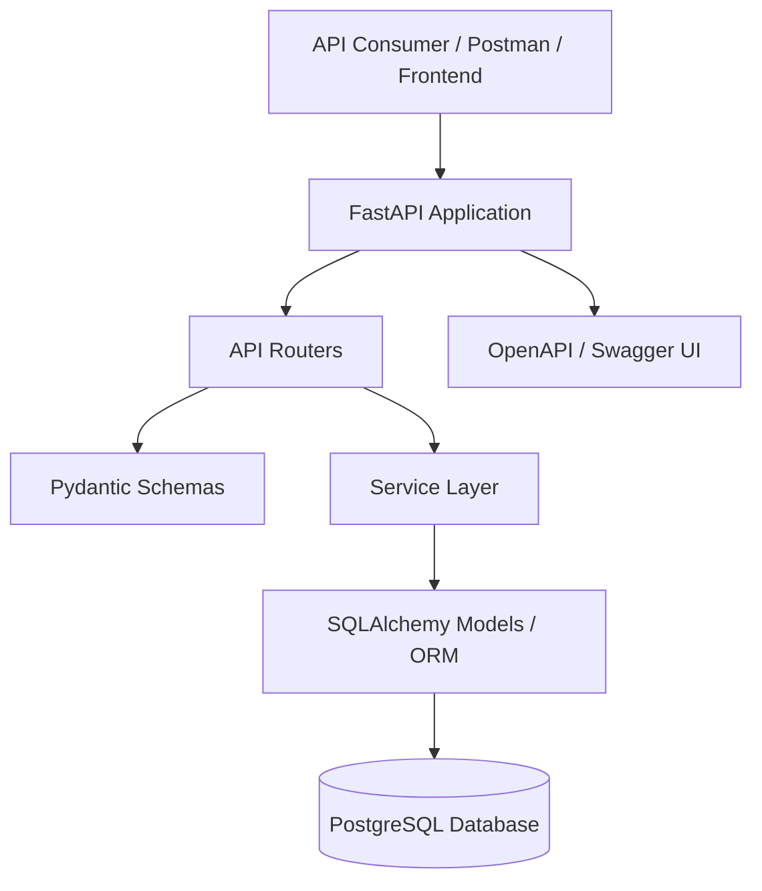

# Architecture
## Corporate Event Management API

**Status:** Implemented layered architecture with lightweight browser frontend  
**Architecture style:** Layered FastAPI application with relational persistence

---

## 1. Architecture goals

- Satisfy the assignment's required separation of concerns.
- Keep HTTP concerns separate from business rules and persistence.
- Make core behavior testable without coupling tests to route handlers.
- Use PostgreSQL as the persistent relational data store.
- Keep configuration and secrets outside source code.
- Leave room for optional features without complicating the mandatory baseline.

## 2. High-level component view



The client sends HTTP requests to FastAPI. Routers receive requests, Pydantic validates data, service functions enforce business rules, and SQLAlchemy performs database operations. FastAPI exposes OpenAPI documentation and Swagger UI.

## 3. Required project structure

```text
corporate-event-management-api/
├── app/
│   ├── __init__.py
│   ├── main.py
│   ├── db.py
│   ├── models.py
│   ├── schemas.py
│   ├── services.py
│   └── routers/
│       ├── __init__.py
│       ├── events.py
│       └── registrations.py
├── tests/
│   ├── __init__.py
│   ├── conftest.py
│   ├── test_events.py
│   └── test_registrations.py
├── docs/
│   ├── screenshots/
│   └── AI_USAGE.md
├── .env.example
├── .gitignore
├── requirements.txt
├── README.md
├── ARCHITECTURE.md
├── DESIGN.md
├── MEMORY.md
├── PRD.md
└── RULES.md
```

The deployed repository also includes root `index.py` as the Vercel FastAPI entry point and `public/` for the browser interface. The structure may be expanded when needed, but the required modules must remain identifiable. For example, configuration can later be extracted to `config.py`, and database-specific repositories can be introduced only if they improve clarity.

## 4. Layer responsibilities

### `main.py` — Application composition
- Create the FastAPI application.
- Configure title, version, and description.
- Register routers.
- Configure startup/lifespan behavior if required.
- Expose the application object for the ASGI server.
- Do not place event or registration business rules here.

### `db.py` — Database setup
- Read the database URL from environment configuration.
- Create the SQLAlchemy engine and session factory.
- Provide a dependency that yields a database session.
- Handle session lifecycle and cleanup.
- Never hard-code credentials.

### `models.py` — Persistence models
- Define SQLAlchemy table mappings.
- Define primary keys, foreign keys, indexes, and uniqueness constraints.
- Represent relationships between events, employees, and registrations.
- Keep HTTP request/response validation out of ORM models.

### `schemas.py` — API data contracts
- Define Pydantic request and response schemas.
- Validate field types and constraints.
- Separate create, update, and response schemas where appropriate.
- Avoid exposing internal database fields or secrets in API responses.

### `services.py` — Business logic
- Implement event creation, retrieval, update, and deletion operations.
- Implement employee registration and cancellation.
- Enforce event existence, duplicate prevention, and capacity rules.
- Raise or return domain-level outcomes that routers translate into HTTP responses.
- Keep business logic out of route functions.

### `routers/events.py` — Event HTTP endpoints
- Declare event routes.
- Declare request/response schema types and status codes.
- Obtain dependencies and call service functions.
- Translate expected service outcomes into suitable HTTP responses.
- Avoid embedding database queries and business rules directly in route handlers.

### `routers/registrations.py` — Registration HTTP endpoints
- Declare registration and cancellation routes.
- Validate request bodies.
- Call registration services.
- Return documented response schemas and status codes.

### `public/` — Browser frontend\n- `index.html` defines the browser UI.\n- `style.css` defines responsive styling.\n- `script.js` calls the same authenticated API endpoints.\n- `assets/` contains local static assets.\n\n### `index.py` — Vercel entry point\n- Exposes the FastAPI application as an ASGI function for Vercel Python runtime.\n\n### `tests/` — Automated verification
- Test API behavior through FastAPI's test client.
- Use an isolated test database or controlled test database configuration.
- Test normal cases and failure cases.
- Do not run destructive tests against a production database.

## 5. Data model

The baseline domain contains three concepts:

```mermaid

erDiagram
    ORGANIZATION ||--o{ APP_USER : contains
    ORGANIZATION ||--o{ EVENT : owns
    APP_USER ||--o{ EVENT : creates
    EVENT ||--o{ REGISTRATION : has
    APP_USER ||--o{ REGISTRATION : makes

    ORGANIZATION {
        uuid id PK
        string name
        datetime created_at
    }

    APP_USER {
        uuid id PK
        uuid organization_id FK
        string full_name
        string email
        string password_hash
        string role
        boolean is_active
        datetime created_at
    }

    EVENT {
        uuid id PK
        uuid organization_id FK
        uuid created_by FK
        string title
        string description
        datetime starts_at
        string location
        int capacity
        datetime created_at
        datetime updated_at
    }

    REGISTRATION {
        uuid id PK
        uuid event_id FK
        uuid employee_id FK
        string status
        datetime created_at
        datetime cancelled_at
    }


### Organization-scoped data access

The application uses an organization-based data model.

The organization relationship works as follows:

1. An organization owns multiple user accounts.
2. An organization owns multiple events.
3. An administrator creates users and events within their organization.
4. An event can have multiple registrations.
5. Each registration belongs to an event and a user.

The current Registration model does not store a separate `organization_id`. Its organization context is derived through its associated Event.

### Application-level enforcement

The authenticated user context contains the user ID, organization ID, and role.

Service-layer queries apply organization filters to event operations.

Registration queries use the related event's organization to enforce organization scoping. Employee cancellation additionally checks registration ownership.

### Security boundaries and limitations

Current tenant scoping is implemented at the application layer.

The current database migration does not define PostgreSQL Row Level Security policies.

The database foreign keys do not independently enforce that a registration's event and employee belong to the same organization.

The authentication lookup uses email without an organization identifier, while email uniqueness is currently scoped to an organization. This creates an account-identity ambiguity if the same email is registered in multiple organizations.

Production-grade tenant isolation requires further database, authentication, and security-test verification.


## 6. Request lifecycle

1. Client sends an HTTP request.
2. FastAPI matches the route.
3. Pydantic validates request data.
4. Router obtains a database session dependency.
5. Router calls the relevant service function.
6. Service checks business rules and performs persistence operations.
7. SQLAlchemy communicates with PostgreSQL.
8. Router returns a response model and appropriate HTTP status.
9. FastAPI serializes the response and exposes it in OpenAPI.

## 7. Database transaction and capacity safety

A simple “read current registrations, then insert” sequence can overbook an event if two requests arrive simultaneously. Capacity enforcement must therefore be implemented transactionally.

Use a database-safe approach appropriate to the selected SQLAlchemy/database configuration, such as locking the event row while checking the active registration count and inserting the registration, or another concurrency-safe design. Add a test or documented manual verification for the capacity boundary.

Do not claim concurrency safety unless the implementation actually provides it.

## 8. Configuration and secrets

Expected environment configuration:
- `DATABASE_URL`
- `APP_ENV` (optional)
- `SECRET_KEY` (only if JWT is implemented)
- token expiry configuration (only if JWT is implemented)

Commit `.env.example` with placeholder values only. Add `.env` to `.gitignore`. Configure production secrets in the hosting provider's environment-variable settings.

## 9. Deployment topology

Proposed deployment flow:

```mermaid
flowchart LR
    Repo[GitHub Repository]
    Host[FastAPI Hosting Provider]
    DB[(Hosted PostgreSQL)]
    User[API Client]
    Repo --> Host
    User --> Host
    Host --> DB
```

Supabase-hosted PostgreSQL was discussed as a free-tier database option. Render was discussed as a possible API host. Vercel was also discussed, but its serverless behavior and database connection strategy require verification before selection. Deployment is not confirmed as a mandatory assignment requirement.

## 10. Testing architecture

- Unit-test service rules where practical.
- API-test endpoints, validation, and HTTP status codes.
- Use test fixtures for database setup and cleanup.
- Cover event CRUD, missing IDs, registration success, duplicate registration, missing event, capacity reached, and cancellation.
- Add pagination/filter/auth/async tests only when those bonus features are implemented.

## 11. Architecture decisions and boundaries

- FastAPI is the API framework.
- PostgreSQL is the relational database.
- SQLAlchemy is the ORM/data access layer.
- Pydantic is the API validation/schema layer.
- GitHub is the source repository.
- Supabase and Render are candidate free-tier hosted services, not mandatory dependencies of local development.
- Multi-tenancy, AI features, payments, and frontend development are outside the confirmed baseline scope.
\n\n## 12. Frontend request flow\n\nThe browser loads static files from `public/`. The JavaScript client calls `/api/v1/*` on the same origin and sends the JWT as a Bearer token. The frontend does not bypass or replace backend validation and authorization.\n